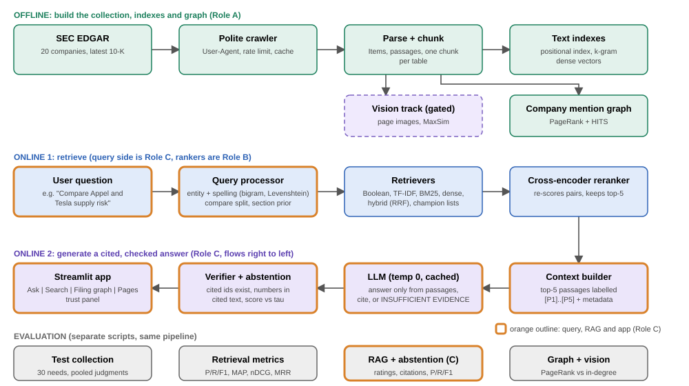

# 6. Proposed model

*Figure 1. Offline build (collection, indexes, graph), the two online stages (retrieve, then generate and check) and the evaluation scripts. The dashed box is the gated vision track. Boxes with an orange outline are the query, RAG and application components. Text retrieval and reranking run on a laptop CPU; generation is one cached language-model call per question.*

TradeMesh answers questions over the latest 10-K filings of about 20 companies. The system has an offline stage that is run once and two online stages that run for every question.

**Offline.** A polite crawler downloads each filing; a parser splits it into passages by 10-K Item, with every table kept as one chunk (caption, header row and rows as text). The passages feed a positional inverted index, dense vectors, a company mention graph and, if the go/no-go gate passes, page-image vectors.

**Online, stage 1 (retrieve).** The *query processor* detects company names with tolerance for spelling errors, removes them from the topical part of the question, and, when two or more companies are named, issues one sub-query per company. The *retrievers* produce a candidate list; an optional section prior re-scores it; the cross-encoder keeps the top five.

**Online, stage 2 (generate and check).** The *context builder* labels the five passages `[P1]` to `[P5]` with ticker, fiscal year and Item. The language model (temperature 0, every call cached) must answer only from them, cite every claim, and otherwise output exactly `INSUFFICIENT EVIDENCE`. A deterministic *verifier* then checks the citations and every number, and an *abstention rule* decides whether to show the answer.

**Application.** The Streamlit app has four tabs:

* **Ask**: the answer with bold `[Pn]` markers, expandable evidence (cited passages open by default), a trust panel with the verifier results, a compare-companies mode and a closed-book toggle that shows the no-evidence baseline.
* **Search**: the classic engine. The user picks up to three retrievers, sees them side by side with key-word-in-context snippets and can filter by company.
* **Filing graph**: the company mention graph with PageRank, hub and authority scores.
* **Pages**: page-image retrieval results from the vision track.

A tab whose back end is not ready shows a "not available yet" message instead of failing.
